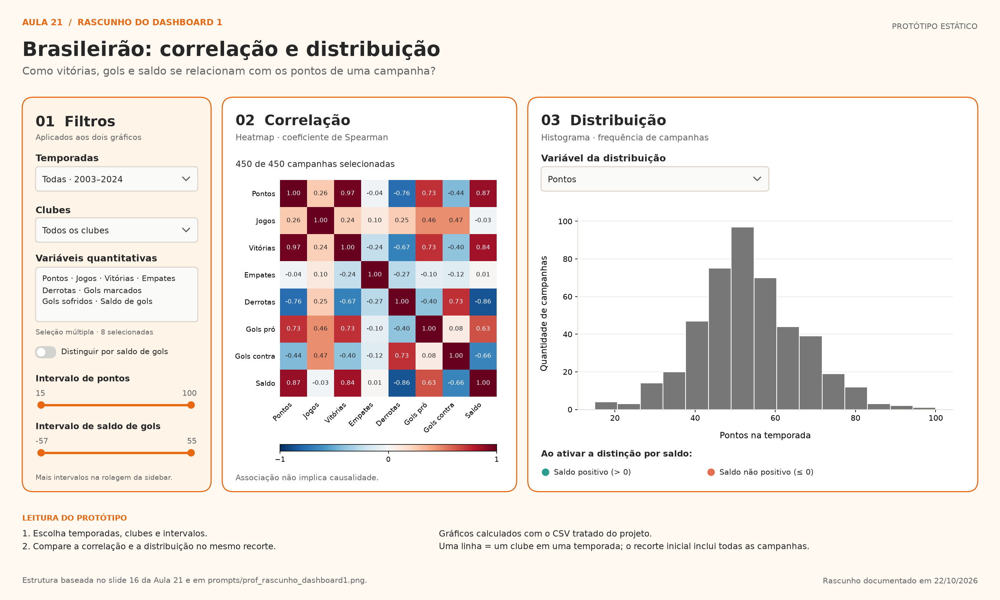

# Prompts

Esta pasta reúne os registros de uso de IA no projeto e serve para dois propósitos:

1. **Template de prompt do rascunho → esqueleto**: [layout-skeleton-prompt.md](layout-skeleton-prompt.md) traz o template de 4 blocos (Contexto, Entrada, Restrições, Formato de saída). Preencha com o caminho do seu rascunho (que fica em [entregas/](../entregas/)), anexe a imagem e envie à ferramenta de IA.
2. **Declaração de Uso de IA**: [declaracao-uso-ia.md](declaracao-uso-ia.md) é exigida pelo Plano de Ensino. Registre a ferramenta usada, o prompt, e o que foi aceito, modificado ou rejeitado e por quê.

Dica: guarde aqui uma cópia dos prompts que você realmente usou, para preencher a declaração de uso de IA de forma mais simples.

Os rascunhos de layout ficam na pasta [entregas/](../entregas/) (veja [entregas/README.md](../entregas/README.md)) e fazem parte do entregável: não os coloque no `.gitignore`.

## Dashboard 1 — Brasileirão

O rascunho para entrega está em [entregas/rascunho-dashboard1.png](../entregas/rascunho-dashboard1.png). A [versão SVG](../entregas/rascunho-dashboard1.svg) preserva formas e textos para edição vetorial. As cópias anteriores em `prompts/rascunho_dashboard1.*` permanecem como histórico. O arquivo [prof_rascunho_dashboard1.png](../entregas/prof_rascunho_dashboard1.png) é a referência da professora.



O desenho segue o slide 16 enviado pelo aluno. As prévias dos gráficos são calculadas com os dados reais do CSV tratado; os controles desenhados representam a interação prevista no Streamlit.

| Área do rascunho | Componente do Streamlit | Comportamento |
| --- | --- | --- |
| Filtros à esquerda | `st.sidebar`, `st.multiselect`, `st.slider`, `st.toggle` | Temporadas, clubes, variáveis e intervalos; distinção por saldo |
| Correlação ao centro | Primeira coluna de `st.columns([1, 1.5])`, `st.plotly_chart` | Spearman das variáveis selecionadas, após os filtros |
| Distribuição à direita | Segunda coluna, `st.selectbox`, `st.plotly_chart` | Histograma da variável selecionada; separação opcional por saldo |

Na interface inicial, os dois gráficos usam todas as campanhas. O toggle começa desligado. O desenho mostra dois sliders como exemplo; o aplicativo tem um para cada variável selecionada, acessível pela rolagem da sidebar. O histograma do rascunho usa 15 classes para a prévia; o app pode calcular as classes automaticamente.

Para regenerar os arquivos usando o CSV atual, execute da raiz:

```powershell
.venv/Scripts/python.exe scripts/gerar_rascunho.py
```

O [prompt de quatro blocos](layout-skeleton-prompt.md) foi aplicado na Parte 1 em 27/10/2026, junto com o rascunho, para revisar o esqueleto de `app.py`: cabeçalho/carregamento, sidebar, aplicação dos filtros, correlação e distribuição. Os cálculos existentes foram preservados e os filtros receberam chaves explícitas. Na Parte 2, essa estrutura passou a integrar a aba de exploração.

O app foi executado e seus seletores e sliders foram verificados. A [declaração de uso de IA](declaracao-uso-ia.md) será preenchida manualmente pelo aluno ao encerrar a atividade, incluindo suas decisões sobre o que aceitou, modificou ou rejeitou.

Este rascunho foi criado após a primeira versão do aplicativo e orientou a revisão de 27/10/2026.

## Dashboard 2 — Aula 22

O planejamento das variáveis, métricas e widgets está em [justificativa-metricas.md](../entregas/justificativa-metricas.md). A partir dele foi desenhado o [rascunho do Dashboard 2](../entregas/rascunho-dashboard2.png), antes de implementar a segunda aba. O código usa indicadores nativos e visuais Altair com seleção de clubes ligada aos KPIs e à evolução temporal. A declaração de uso de IA permanece para preenchimento manual pelo aluno.
